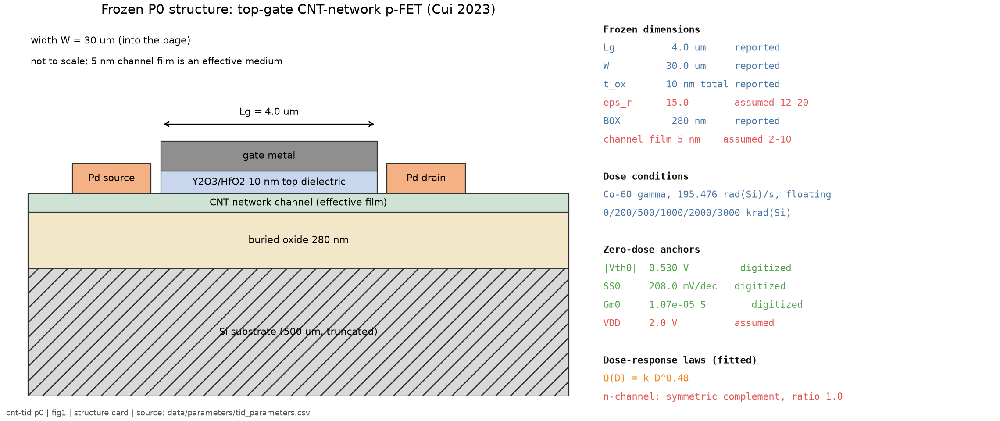
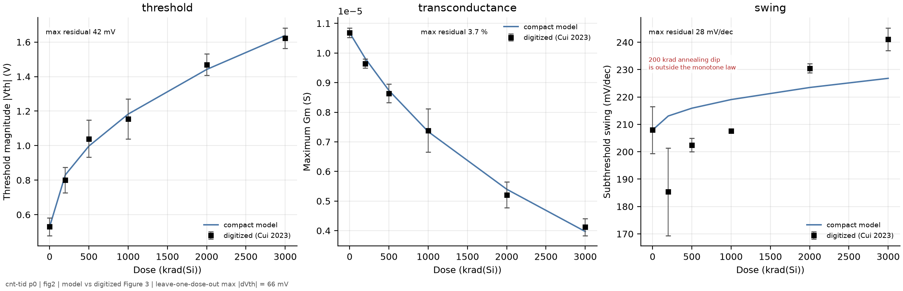
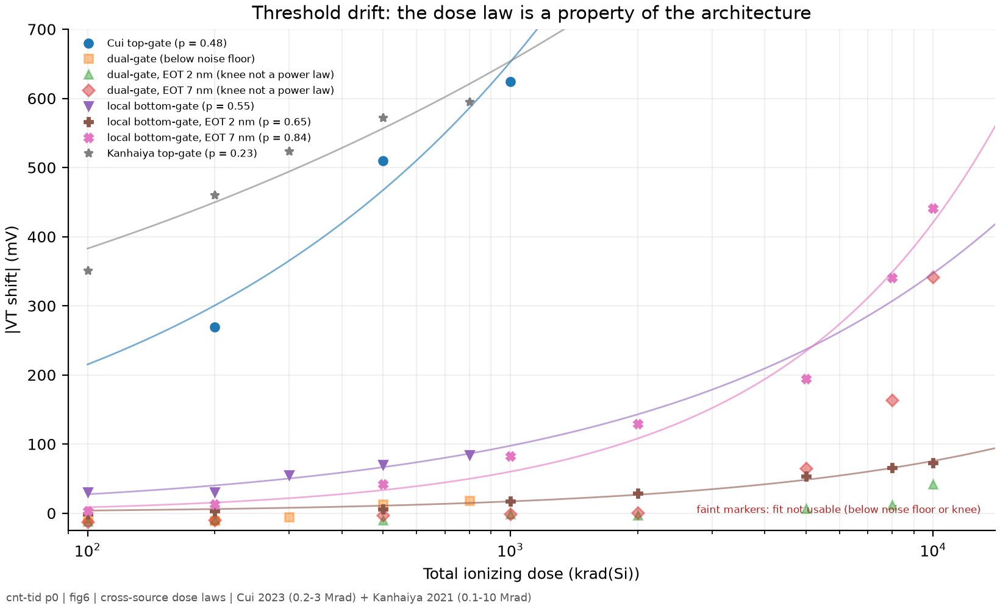

# P0 结项报告：文献锚定的 CNTFET 总剂量效应紧凑模型

**版本** v0.6.0 · **结项日期** 2026-11-17 · **剂量单位** krad(Si)

---

## 0. 一页结论

P0 的五项要求已经形成一个闭环，且每一环都能被独立复算：

1. **结构已冻结**：Cui 2023 顶栅 CNT 网络 p-FET，Lg = 4 µm、W = 30 µm、Y₂O₃/HfO₂ 顶栅 10 nm、BOX 280 nm、Pd 源漏。
2. **TID 参数可追溯**：论文 Figure 3 的三个子图由 PDF 矢量内容直接数字化（不是手工读数），再按论文自身的 Eq.(1)–(3) 反推为紧凑参数。
3. **器件与反相器剂量扫描**：0–3000 krad(Si) 六点，器件转移特性、反相器 VTC 与静态指标齐备。
4. **标定与敏感性**：拟合残差、留一剂量点验证、OAT 弹性系数、假设区间扫描四层证据。
5. **可复现代码与结项图表**：`cnt-tid p0` 一条命令重建全部结果，输出 SHA-256 清单；图 1–图 6 见 `docs/figures/p0/`。
6. **跨文献校验**：第二份实测数据（Kanhaiya 2021，4 种几何、0.1–10 Mrad）表明剂量律的指数在 0.23–0.85 之间随结构变化，跨结构迁移误差可达 2–5 倍——"一组通用 TID 参数"不成立，参数必须绑定结构（第 7 节）。

**核心数字**

| 量 | 值 | 说明 |
| --- | --- | --- |
| 剂量律指数 p | **0.482** | Q(D) = k·D^p，亚线性陷阱积累 |
| Q_it 斜率 | **8.90 × 10⁻⁹ C/cm²/krad^p** | 由亚阈摆幅退化经 Eq.(3) 反推 |
| Q_ot 斜率 | **2.22 × 10⁻⁸ C/cm²/krad^p** | 总电荷扣减界面分量 |
| 3 Mrad 总陷阱电荷 | **1.47 × 10⁻⁶ C/cm²** | 对应 \|ΔVth\| = 1.108 V |
| 迁移率退化 αμ | **5.46 × 10⁻⁴ /krad** | μ = μ₀/(1+αμD)，μ₀ = 21.4 cm²/Vs |
| 阈值残差（6 点） | **≤ 42.3 mV** | 相对 1.6 V 量程约 2.6 % |
| 留一剂量点残差 | **≤ 65.5 mV** | 预测能力而非拟合能力 |
| 反相器 VM | **1.000 → 0.129 V** | 0 → 3 Mrad |
| 噪声容限 | **0.771 → 0.124 / 0.225 V** | NML / NMH，损失 84 % / 71 % |
| 跨结构指数范围 | **0.23 – 0.85** | 7 个器件变体，同一幂律族、不同结构 |

**一句话物理解释**：正氧化层陷阱使 n 型阈值下移、p 型阈值幅值上移，两者方向相反；在 2 V 电源下这条互补对在 3000 krad(Si) 时阈值间隔已超过电源电压，开关点被挤到接近地电平，电路退化由"阈值反向漂移"而非迁移率主导（图 4 中 p.qot_slope 与 p.threshold_v 的弹性分别为 −0.77 与 −0.72）。

---

## 1. 交付物对照表

| P0 要求 | 交付物 | 位置 |
| --- | --- | --- |
| 一种明确结构的 CNTFET | 结构卡（图 1）+ 机器可读参数 + 冻结配置 | `docs/figures/p0/fig1_structure.png`、`data/parameters/tid_parameters.csv`、`configs/p0/cntfet_tid_p0.toml` |
| 一组可追溯的 TID 参数 | 矢量化数字脚本 + 数字化 CSV + 审计 JSON + 解析后的参数表 | `scripts/digitize_cui2023_fig3.py`、`data/literature/cui2023_topgate/fig3_metrics_digitized.csv`、`results/p0/parameters_resolved.csv` |
| 器件与反相器剂量扫描 | 6 个剂量点的转移特性、VTC、指标汇总 | `results/p0/dose_sweep/`、图 3 |
| 标定与敏感性分析 | 残差、留一验证、OAT 龙卷风、假设区间 | `results/p0/calibration/`、`results/p0/sensitivity/`、`results/p0/robustness/`、图 2/4/5 |
| 可复现代码与结项图表 | 单一命令重建 + SHA-256 清单 + 测试 | `cnt-tid p0`、`results/p0/manifest.json`、`docs/figures/p0/` |
| 参数的适用范围（附加） | 跨 2 篇文献、7 个器件变体的剂量律对比与迁移误差 | `results/p0/cross_source/`、图 6、第 7 节 |

---

## 2. 冻结结构



图中每个尺寸都带溯源标记：蓝色 = 论文明确给出，红色 = 工程假设（附区间），绿色 = 从论文图表数字化得到，橙色 = 本次标定拟合。

| 参数 | 值 | 溯源 | 来源 |
| --- | --- | --- | --- |
| 栅长 Lg | 4.0 µm | reported | Cui 2023 第 2 节，第 3 页 |
| 栅宽 W | 30.0 µm | reported | 同上 |
| 顶栅介质厚度 | 10 nm（Y₂O₃/HfO₂ 合计） | reported | 同上 |
| 顶栅等效介电常数 | 15（区间 12–20） | assumed | 两层厚度未报告，按 Y₂O₃(13–15)/HfO₂(20–25) 串联等效估计 |
| 埋氧 | 280 nm | reported | 同上 |
| 衬底 | 500 µm Si（可截断） | reported | 同上 |
| CNT 网络有效膜厚 | 5 nm（区间 2–10） | assumed | 仅用于结构示意，不参与紧凑模型 |
| 剂量点 | 0/200/500/1000/2000/3000 krad(Si) | reported | 第 2 节、Table 1、Figure 2 |
| 辐照条件 | Co-60 γ，195.476 rad(Si)/s，各端浮空 | reported | 第 2 节 |
| 电源电压 VDD | 2.0 V（区间 1.5–2.5） | assumed | 与论文 \|VDS\| = 2 V 饱和测试一致 |

**n 型器件是显式假设**：论文只测了 p 型，反相器所需的 n 型按"对称互补"构造，剂量响应乘以 `assume.n_p_dose_response_ratio`（基线 1.0，区间 0.5–1.5）。该比值对电路结论的影响见 §7，这是本报告最重要的不确定性来源。

---

## 3. 参数溯源链

```
reference/literature/electronics-12-01000.pdf  (SHA-256 c69262f9…537)
        │  scripts/digitize_cui2023_fig3.py   ← 只读矢量内容，不改写数值
        ▼
data/literature/cui2023_topgate/fig3_metrics_digitized.csv  (18 行 = 6 剂量 × 3 指标)
        │  fig3_digitization_report.json      ← 坐标轴标定系数、PDF 哈希、PyMuPDF 版本
        ▼
src/cnt_tid/metric_calibration.py             ← 按 Eq.(1)(2)(3) 反推
        │  results/p0/calibration/{residuals,holdout}.csv
        ▼
data/parameters/tid_parameters.csv + 标定结果 → configs/p0/cntfet_tid_p0.toml
        │  config_sha256 = 6259d2b2…217f
        ▼
results/p0/{dose_sweep,validation,sensitivity,robustness,figures}
        │
        ▼
results/p0/parameters_resolved.csv + manifest.json（每个文件的 SHA-256）
```

数字化不是"看着图抄数"：脚本读取 PDF 内容流里填充方块标记的中心坐标，用排版刻度的中心做线性标定（Figure 3a 的 y 轴残差 1.1 × 10⁻¹⁵，x 轴残差 0.5 krad），再按已知剂量网格 {0,200,500,1000,2000,3000} 吸附。图例色块会被"VDS 文本 + 位于其左侧 4–30 pt"规则排除。审计图 `results/literature/fig3_overlay.png` 把复原点叠加在原文上，可人工核对。

复算命令：

```bash
python scripts/digitize_cui2023_fig3.py     # 需要 [digitize] 依赖（pymupdf）
```

---

## 4. 模型

沿用 `docs/modeling.md` 的等效链路，P0 增加三处可标定的扩展（均在配置中显式开关）：

1. **剂量幂律**：Q(D) = k·D^p（`dose_exponent`）。p = 1 即原线性律；实测阈值漂移明显亚线性，线性律在 1000 krad 处会偏差约 0.2 V。
2. **摆幅由界面电荷驱动**：n(D) = n₀ + Q_it(D)/Cox（`slope_factor_from_qit`），即论文 Eq.(3) 的形式，而不是独立的线性系数。
3. **反相器轨钳位**：电流平衡方程在 [0, VDD] 内无解时按物理极限钉在轨上，而不是抛异常——这正是高剂量下"输出被拉死"的情形。

标定链路（`metric_calibration.py`）：

- **阈值**：|Vth(D)| − |Vth(0)| = Q_tot(D)/Cox，对 Q_tot = k·D^p 做非线性最小二乘；
- **界面电荷**：由 Eq.(3)，n = SS/(ln10·kT/q)，Q_it(D) = Cox·(n−n₀)，与阈值共用同一个 p；
- **氧化层电荷**：Q_ot = Q_tot − Q_it（并强制为正）；
- **迁移率**：在探针条件（VDS = 0.1 V，|VGS| 0…2 V，即论文扫描范围）下**反演紧凑模型**，令模型最大跨导等于数字化的 Gm；αμ 再对模型 Gm 做一维拟合，而不是对 1/μ 做线性回归——这样阈值和摆幅漂移对 Gm 的影响不会被错误地塞进迁移率。

---

## 5. 标定与验证



| 剂量 krad(Si) | \|Vth\| 数据 (V) | 模型 (V) | 残差 (mV) | Gm 数据 (S) | 模型 (S) | 相对残差 | SS 数据 | SS 模型 | 残差 |
| --- | --- | --- | --- | --- | --- | --- | --- | --- | --- | --- |
| 0 | 0.530 | 0.530 | +0.0 | 1.068e-05 | 1.068e-05 | +0.0 % | 208.0 | 208.0 | +0.0 |
| 200 | 0.799 | 0.831 | −31.1 | 9.646e-06 | 9.813e-06 | −1.7 % | 185.4 | 213.1 | −27.7 |
| 500 | 1.040 | 0.997 | +42.3 | 8.636e-06 | 8.736e-06 | −1.2 % | 202.4 | 215.9 | −13.5 |
| 1000 | 1.154 | 1.183 | −28.6 | 7.385e-06 | 7.346e-06 | +0.5 % | 207.6 | 219.1 | −11.5 |
| 2000 | 1.469 | 1.441 | +27.9 | 5.208e-06 | 5.399e-06 | −3.7 % | 230.5 | 223.5 | +7.0 |
| 3000 | 1.622 | 1.638 | −15.6 | 4.119e-06 | 3.971e-06 | +3.6 % | 241.1 | 226.8 | +14.2 |

零剂量行的残差恒为 0：Vth₀、SS₀ 与 μ₀ 由该点直接锚定，因此这三列检验的是**剂量律的形状**，不是零剂量拟合。

**留一剂量点验证**（每次剔掉一个非零剂量重新拟合，再预测被剔点）：

| 留出剂量 | ΔVth 残差 | ΔGm 相对残差 | ΔSS 残差 |
| --- | --- | --- | --- |
| 200 | −50.1 mV | −1.7 % | −28.9 mV/dec |
| 500 | +65.5 mV | −1.4 % | −14.5 mV/dec |
| 1000 | −38.7 mV | +0.5 % | −13.6 mV/dec |
| 2000 | +40.2 mV | −5.3 % | +10.0 mV/dec |
| 3000 | −51.6 mV | +8.1 % | +24.8 mV/dec |

预测误差约为拟合误差的 1.5 倍，仍小于阈值的 4 %，可用于趋势与裕度判断，不足以支撑寿命外推。

**两个必须写明的方法学结论**

1. **200 krad 的摆幅谷无法被单调模型复现**。论文 Figure 3c 在此处回落到 185 mV/dec，随后再上升；单段幂律给出 213 mV/dec，残差 −27.7 mV/dec。论文本身把该现象归因于辐照下的缺陷退火/界面修复，属于两阶段机制。P0 选择保留单调律并显式报告残差，而不是加一个无额外数据支撑的三次项。
2. **αμ 是有效系数**。由于 Gm 同时受阈值漂移与摆幅变化影响，仅凭 Figure 3b 无法把"迁移率退化"与"跨导工作点移动"完全解耦；αμ 应理解为在论文扫描条件下的等效退化率，图 2 中 Gm 的 3.7 % 残差即是该近似的量化。

---

## 6. 器件与反相器剂量扫描


| 剂量 | \|Vth_p\| (V) | Vth_n (V) | Q_tot (C/cm²) | μ (cm²/Vs) | VM (V) | NML (V) | NMH (V) |
| --- | --- | --- | --- | --- | --- | --- | --- | --- |
| 0 | 0.530 | 0.530 | 0 | 21.4 | 1.000 | 0.771 | 0.771 |
| 200 | 0.831 | 0.229 | 3.99e-07 | 19.7 | 0.728 | 0.470 | 1.069 |
| 500 | 0.997 | 0.063 | 6.21e-07 | 17.6 | 0.583 | 0.303 | 1.227 |
| 1000 | 1.183 | −0.123 | 8.67e-07 | 15.0 | 0.430 | 0.117 | 1.368 |
| 2000 | 1.441 | −0.381 | 1.21e-06 | 11.5 | 0.242 | 0.320 | 1.271 |
| 3000 | 1.638 | −0.578 | 1.47e-06 | 9.3 | 0.129 | 0.124 | 0.225 |

解读：

- **1000 krad 是转折点**：n 型阈值幅值越过 0，意味着 n 管在零栅压时已导通，反相器的下拉支路失去关断能力。VTC 的拐点从 1.0 V 被推到 0.43 V（1000 krad）与 0.13 V（3000 krad）。
- **VOH 也开始塌陷**：3000 krad 时 Vin = 0 的输出只有 1.55 V（图 3 左图曲线起点），因为 n 管漏电始终存在。这是辐照导致的静态功耗上升，而不是数值误差。
- **NMH 先升后降**：中间剂量段 VOL 抬升使 NMH 表观变大（1.07 → 1.37 V），随后在 3000 krad 因为 VOH 塌陷而骤降。噪声容限单独看会误导，应与 VM 一起读。
- 全程 VM 有限、反相器仍可开关（`inverter_switching_maintained = true`），但 3 Mrad 时静态噪声容限只剩初始的 16 % / 29 %。

---

## 7. 跨文献校验：剂量律属于结构，不是常数



P0 主线只用了 Cui 2023 一个 p 型器件。第二份数据（Kanhaiya et al., ACS Nano 2021）提供了四种 CNFET 几何、两种 EOT、0.1–10 Mrad 的 `|ΔV_T|` 测量值。同样按 `|ΔV_T| = a·D^p` 拟合（过原点，非线性最小二乘）：

| 器件 | 几何 | EOT (nm) | 剂量范围 (krad) | a (mV/krad^p) | p | R² | 最大残差 (mV) | 判定 |
| --- | --- | --- | --- | --- | --- | --- | --- | --- |
| Cui 2023 | top-gate CNT 网络 | 2.6 | 200–3000 | 23.4 | **0.482** | 0.989 | 42 | 幂律 |
| Kanhaiya 2021 | top-gate | 7 | 100–800 | 131 | **0.233** | 0.925 | 31 | 幂律（饱和型） |
| Kanhaiya 2021 | local bottom-gate | 7 | 100–800 | 2.17 | 0.551 | 0.940 | 9.3 | 幂律 |
| Kanhaiya 2021 | local bottom-gate | 7 | 100–10000 | 0.175 | 0.845 | 0.983 | 40 | 幂律 |
| Kanhaiya 2021 | local bottom-gate | 2 | 100–10000 | 0.197 | 0.646 | 0.985 | 5.3 | 幂律 |
| Kanhaiya 2021 | dual-gate | 7 | 100–10000 | — | (2.84) | 0.995 | 18 | 折点，非幂律 |
| Kanhaiya 2021 | dual-gate | 2 | 100–10000 | — | (4.89) | 0.976 | 5.7 | 折点，非幂律 |
| Kanhaiya 2021 | dual-gate | 7 | 100–800 | — | — | — | — | 低于噪声底（峰值 18 mV） |

**三条结论**

1. **指数不是常数**。可用的幂律拟合给出 p = 0.23–0.85，与 P0 主线的 0.482 相差最多 3.6 倍。同样是"顶栅"，Cui 的 p 型网络器件是 0.48，Kanhaiya 的顶栅是 0.23（明显饱和）——说明曲线形状由栅氧/钝化/几何决定，不能从一个器件外推到另一个。
2. **迁移一条拟合律的代价可以量化**。把 Cui 的 (a, p) 重新锚定到目标器件的第一个测量点（即"用户手里还有一个数据点"这一最有利情形），再外推到该器件的最长剂量：

   | 目标器件 | 锚点 | 末端实测 (mV) | 迁移预测 (mV) | 相对误差 | RMSE (mV) |
   | --- | --- | --- | --- | --- | --- |
   | local bottom-gate | 100 krad | 84.1 | 82.1 | −2 % | 5.8 |
   | local bottom-gate, EOT 7 nm | 200 krad | 441 | 85.9 | **−81 %** | 179 |
   | local bottom-gate, EOT 2 nm | 1000 krad | 72.5 | 52.8 | −27 % | 14.1 |
   | top-gate (Kanhaiya) | 100 krad | 595 | 957 | **+61 %** | 187 |
   | dual-gate, EOT 7 nm | 5000 krad | 342 | 90.8 | **−73 %** | 152 |

   即：即使有一个实测点做锚定，跨结构迁移仍可能差 2–5 倍。**这直接回答了"一组 TID 参数能否通用"：不能，必须按结构标定。**
3. **dual-gate 出现折点**。两种 EOT 的 dual-gate 在约 5 Mrad 之前基本贴零，之后快速上升（p 拟合值 2.8–4.9）。这不是幂律能描述的形状，本报告把它单列为"折点"，不参与指数统计。

对 P0 主线的意义：主线用的 `|ΔV_T| = a·D^p` 是**结构专属**的拟合，报告与代码都把它绑定到具体器件（`configs/p0/cntfet_tid_p0.toml`）；换成 bottom-gate 或 dual-gate 结构必须重新标定，而不是改一个系数。

数据与复算：`data/literature/kanhaiya2021/`（`source.md`、`vt_shift_vs_tid.csv`、`digitization_report.json`）、`scripts/digitize_kanhaiya2021.py`、`results/p0/cross_source/`。

---

## 8. 敏感性与不确定性


VM 的 OAT 弹性（±10 % 扰动，3000 krad 处）：

| 参数 | 弹性 |
| --- | --- |
| p.qot_slope | −0.767 |
| p.threshold_v | −0.718 |
| n.threshold_v | +0.337 |
| n.mobility_m2_vs | −0.304 |
| p.mobility_m2_vs | +0.304 |
| p.qit_slope | −0.299 |
| n.qot_slope | −0.293 |

结论：**决定电路退化的是 p 型的陷阱电荷斜率与零剂量阈值**，其次是 n/p 两管的失配。迁移率类参数只有 ±0.30 的弹性，属于二阶因素。


两个假设的区间扫描给出关键区分：

- **εr 假设不影响电学预测**。因为剂量律是用"伏特"锚定的（ΔVth 来自数据），Q = k·D^p 与 ΔV = Q/Cox 中的 Cox 精确约去；εr 从 12 变到 20 只改报告的电荷标度（3 Mrad 处 1.18 → 1.96 µC/cm²），VM 曲线完全重合。这既是好消息（结论对未知的介质常数鲁棒），也提醒：**报告电荷数值时必须同时报告 Cox 假设**。
- **n/p 比是真不确定度**。0.5 → 1.5 使 3000 krad 的 VM 从 0.203 V 变到 0.104 V，NML 从 0.006 V 变到 0.017 V。P1 的首要任务就是补 n 型实验或 TCAD 数据。

---

## 9. 复现

```powershell
# 1) 安装
python -m pip install -e ".[dev,digitize]"

# 2) 可选：从 PDF 重新数字化两篇文献的图
python scripts/digitize_cui2023_fig3.py        # Cui 2023 Figure 3
python scripts/digitize_kanhaiya2021.py        # Kanhaiya 2021 Figure 3e / 4

# 3) 一条命令重建全部 P0 结果与图表
cnt-tid p0
```

产物：

| 路径 | 内容 |
| --- | --- |
| `results/p0/config_resolved.toml` | 解析后的完整配置（可直接 `cnt-tid run --config` 重跑） |
| `results/p0/parameters_resolved.csv` | 全部参数 + 溯源类别 + 来源 + 不确定性 |
| `results/p0/calibration/` | 残差、留一验证、完整报告 JSON |
| `results/p0/dose_sweep/` | 转移特性、VTC、指标、元数据、原始图 |
| `results/p0/validation/model_vs_literature.csv` | 模型与文献逐点对照 |
| `results/p0/sensitivity/`、`robustness/` | OAT 与假设区间 |
| `results/p0/cross_source/` | 两篇文献 7 个器件变体的剂量律拟合、迁移误差与合并数据表 |
| `results/p0/figures/`、`docs/figures/p0/` | 图 1–6（后者随仓库提交） |
| `results/p0/manifest.json` | 输入与全部输出的 SHA-256、软件版本、时间戳 |

环境：Python 3.12.10、numpy 2.5.5、scipy 1.18.1、pandas 3.1.1、matplotlib 3.11.2、PyMuPDF 2.1。配置指纹 `config_sha256 = 6259d2b2d79229832e181eb8c63bf59f634f6524a106742a484a09a81144217f`。

质量门：`pytest` 64 项全过，`ruff check` 无告警；CI 覆盖 run / calibrate / sensitivity / matrix / p0 五条主流程。

---

## 10. 局限与 P1 计划

**已知局限（按影响排序）**

1. **n 型无数据**：反相器结论条件于 n/p 比 1.0，区间 0.5–1.5 已量化（§7）。
2. **只有三个指标，没有完整 Id–Vg 曲线**：Figure 2 是位图，未数字化；因此标定约束是 18 个数而不是上千个点，模型形状（EKV 平滑）未被数据检验。
3. **摆幅非单调**：200 krad 的谷未被建模，残差 27.7 mV/dec。
4. **缺少接触、量子电容、双极性分支**：论文曲线在正栅压侧的电流回升（双极性）未被紧凑模型包含，故 `Ioff` 与 `Ion` 只能作趋势比较。
5. **跨结构参数不可移植**：第 7 节表明剂量律的指数随结构在 0.23–0.85 之间变化，跨结构迁移误差 2–5 倍。当前 P0 配置只对 Cui 2023 的顶栅器件有效，换结构必须重新标定。
6. **器件间与工艺离散**：Kanhaiya 2021 给出 256 器件阵列的 95 % 置信区间，本项目的紧凑模型只拟合均值曲线，不含离散分布与剂量率依赖。
7. **TCAD 未接入本链条**：`tcad/cntfet/topgate/` 仍是参数补齐阶段，本报告的 TCAD 部分只交付了已连通的冒烟链路。

**P1 优先级**

| 优先级 | 任务 | 验收 |
| --- | --- | --- |
| P1-1 | 补 n 型 CNTFET 的 TID 数据（实验或 TCAD） | n/p 比从假设变为拟合量 |
| P1-2 | 数字化 Figure 2 的 6 条 Id–Vg 曲线 | 全曲线残差 < 0.3 decade |
| P1-3 | 两阶段陷阱模型（建立 + 退火） | 复现 200 krad 摆幅谷 |
| P1-4 | 用 SDE 结构卡生成 CNTFET 网格并与紧凑模型对齐零剂量 | SDevice 零剂量与紧凑模型偏差 < 20 % |
| P1-5 | 反相器混合模式 / 环振 | 频率退化曲线 |

---

## 11. 参考

1. Ding H., Cui J., Zheng Q., et al. *Effect of Trapped Charge Induced by Total Ionizing Dose Radiation on the Top-Gate Carbon Nanotube Field Effect Transistors.* Electronics **12**(4), 1000, 2023. [doi:10.3390/electronics12041000](https://doi.org/10.3390/electronics12041000)
2. Lee C.-S., et al. *A Compact Virtual-Source Model for Carbon Nanotube FETs in the Sub-10-nm Regime.* IEEE TED, 2015. [doi:10.1109/TED.2015.2457424](https://doi.org/10.1109/TED.2015.2457424)
3. 项目内文档：`docs/modeling.md`（模型与单位）、`docs/experiment-matrix.md`（实验矩阵）、`docs/roadmap.md`（计划）、`docs/tcad-user-guide.md`（TCAD 操作）。
