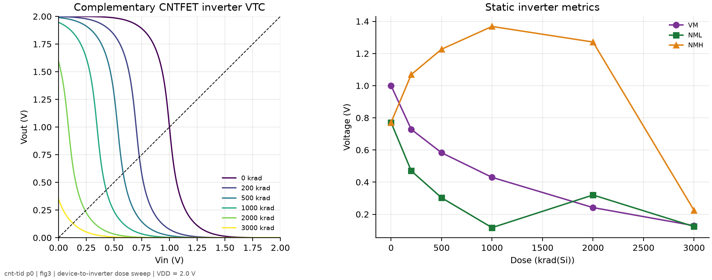
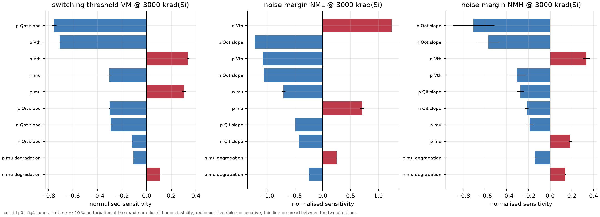
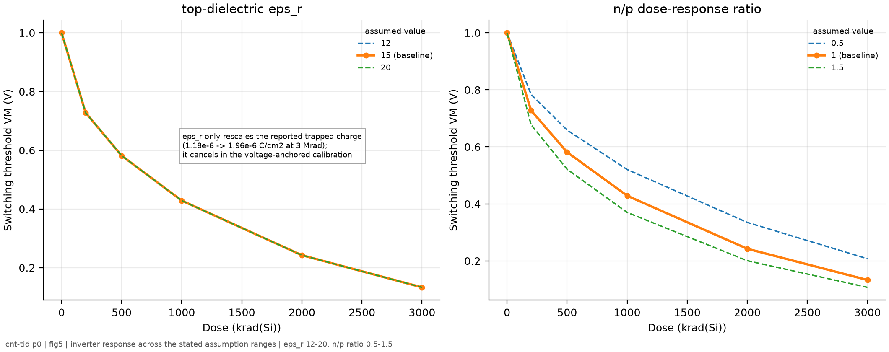
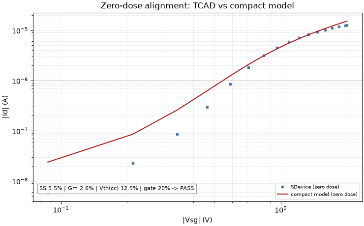
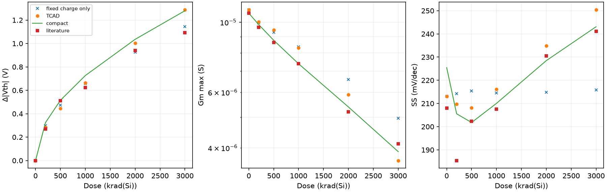
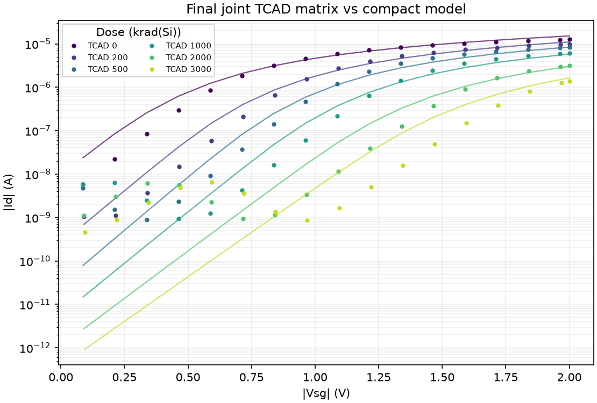

# P0 结项报告：文献锚定的 CNTFET 总剂量效应紧凑模型

**版本** v0.13.0 · **结项日期** 2026-11-18 · **剂量单位** krad(Si)

---

## 0. 一页结论

P0 的五项要求已经形成一个闭环，且每一环都能被独立复算：

1. **结构已冻结**：Cui 2023 顶栅 CNT 网络 p-FET，Lg = 4 µm、W = 30 µm、Y₂O₃/HfO₂ 顶栅 10 nm、BOX 280 nm、Pd 源漏。
2. **TID 参数可追溯**：论文 Figure 3 的三个子图由 PDF 矢量内容直接数字化（不是手工读数），再按论文自身的 Eq.(1)–(3) 反推为紧凑参数。
3. **器件与反相器剂量扫描**：0–3000 krad(Si) 六点，器件转移特性、反相器 VTC 与静态指标齐备。
4. **标定与敏感性**：拟合残差、留一剂量点验证、OAT 弹性系数、假设区间扫描四层证据。
5. **可复现代码与结项图表**：`cnt-tid p0` 一条命令重建全部结果，输出 SHA-256 清单；图 1–图 6 见 `docs/figures/p0/`。
6. **跨文献校验**：第二份实测数据（Kanhaiya 2021，4 种几何、0.1–10 Mrad）表明剂量律的指数在 0.23–0.85 之间随结构变化，跨结构迁移误差可达 2–5 倍——"一组通用 TID 参数"不成立，参数必须绑定结构（第 7 节）。

**核心数字**

| 量 | 值 | 说明 |
| --- | --- | --- |
| 剂量律指数 p | **0.482** | Q(D) = k·D^p，亚线性陷阱积累 |
| Q_it 斜率 | **8.90 × 10⁻⁹ C/cm²/krad^p** | 阈值通道的界面电荷拆分（记账量，见第 4 节） |
| Q_ot 斜率 | **2.22 × 10⁻⁸ C/cm²/krad^p** | 总电荷扣减界面分量 |
| 摆幅密度生成斜率 | **3.90 × 10⁻⁸ C/cm²/krad^p** | 两阶段摆幅通道的生成项 |
| 退火当量 / 尺度 | **1.07 × 10⁻⁶ C/cm² / 239 krad** | 两阶段摆幅通道的饱和退火项 |
| 3 Mrad 总陷阱电荷 | **1.47 × 10⁻⁶ C/cm²** | 对应 \|ΔVth\| = 1.108 V |
| 迁移率退化 αμ | **5.46 × 10⁻⁴ /krad** | μ = μ₀/(1+αμD)，μ₀ = 21.4 cm²/Vs |
| 阈值残差（6 点） | **≤ 42.3 mV** | 相对 1.6 V 量程约 2.6 % |
| 摆幅残差（6 点） | **≤ 17.9 mV/dec** | 全部 ≤ 1.1σ；200 krad 谷被两阶段律复现 |
| 留一剂量点残差 | **≤ 65.5 mV (Vth)** | 预测能力而非拟合能力 |
| 反相器 VM | **1.000 → 0.133 V** | 0 → 3 Mrad |
| 噪声容限 | **0.771 → 0.127 / 0.232 V** | NML / NMH，损失 84 % / 70 % |
| 11 级环振频率 | **4.23 MHz → 399 kHz** | 准静态模型，坍缩 10.6×（图 7） |
| 静态功耗 | **19.5 nW → 7.5 µW（×385）** | 占比 0.007 % → 21 %，n 管失去关断能力 |
| 跨结构指数范围 | **0.23 – 0.85** | 7 个器件变体，同一幂律族、不同结构 |

**一句话物理解释**：正氧化层陷阱使 n 型阈值下移、p 型阈值幅值上移，两者方向相反；在 2 V 电源下这条互补对在 3000 krad(Si) 时阈值间隔已超过电源电压，开关点被挤到接近地电平，电路退化由"阈值反向漂移"而非迁移率主导（图 4 中 p.qot_slope 与 p.threshold_v 的弹性分别为 −0.77 与 −0.72）。

---

## 1. 交付物对照表

| P0 要求 | 交付物 | 位置 |
| --- | --- | --- |
| 一种明确结构的 CNTFET | 结构卡（图 1）+ 机器可读参数 + 冻结配置 | `docs/figures/p0/fig1_structure.png`、`data/parameters/tid_parameters.csv`、`configs/p0/cntfet_tid_p0.toml` |
| 一组可追溯的 TID 参数 | 矢量化数字脚本 + 数字化 CSV + 审计 JSON + 解析后的参数表 | `scripts/digitize_cui2023_fig3.py`、`data/literature/cui2023_topgate/fig3_metrics_digitized.csv`、`results/p0/parameters_resolved.csv` |
| 器件与反相器剂量扫描 | 6 个剂量点的转移特性、VTC、指标汇总 | `results/p0/dose_sweep/`、图 3 |
| 标定与敏感性分析 | 残差、留一验证、OAT 龙卷风、假设区间 | `results/p0/calibration/`、`results/p0/sensitivity/`、`results/p0/robustness/`、图 2/4/5 |
| 可复现代码与结项图表 | 单一命令重建 + SHA-256 清单 + 测试 | `cnt-tid p0`、`results/p0/manifest.json`、`docs/figures/p0/` |
| 参数的适用范围（附加） | 跨 2 篇文献、7 个器件变体的剂量律对比与迁移误差 | `results/p0/cross_source/`、图 6、第 7 节 |
| TCAD 一致性验证（v0.13.0） | 零剂量、三档网格、六剂量点双模型、原生日志与 SHA-256 清单 | `cnt-tid tcad-reproduce`、`results/tcad/reproduced/`、第 9 节 |

---

## 2. 冻结结构


图中每个尺寸都带溯源标记：蓝色 = 论文明确给出，红色 = 工程假设（附区间），绿色 = 从论文图表数字化得到，橙色 = 本次标定拟合。

| 参数 | 值 | 溯源 | 来源 |
| --- | --- | --- | --- |
| 栅长 Lg | 4.0 µm | reported | Cui 2023 第 2 节，第 3 页 |
| 栅宽 W | 30.0 µm | reported | 同上 |
| 顶栅介质厚度 | 10 nm（Y₂O₃/HfO₂ 合计） | reported | 同上 |
| 顶栅等效介电常数 | 15（区间 12–20） | assumed | 两层厚度未报告，按 Y₂O₃(13–15)/HfO₂(20–25) 串联等效估计 |
| 埋氧 | 280 nm | reported | 同上 |
| 衬底 | 500 µm Si（可截断） | reported | 同上 |
| CNT 网络有效膜厚 | 5 nm（区间 2–10） | assumed | 仅用于结构示意，不参与紧凑模型 |
| 剂量点 | 0/200/500/1000/2000/3000 krad(Si) | reported | 第 2 节、Table 1、Figure 2 |
| 辐照条件 | Co-60 γ，195.476 rad(Si)/s，各端浮空 | reported | 第 2 节 |
| 电源电压 VDD | 2.0 V（区间 1.5–2.5） | assumed | 与论文 \|VDS\| = 2 V 饱和测试一致 |

**n 型器件是显式假设**：论文只测了 p 型，反相器所需的 n 型按"对称互补"构造，剂量响应乘以 `assume.n_p_dose_response_ratio`（基线 1.0，区间 0.5–1.5）。该比值对电路结论的影响见 §7，这是本报告最重要的不确定性来源。

---

## 3. 参数溯源链

```
reference/literature/electronics-12-01000.pdf  (SHA-256 c69262f9…537)
        │  scripts/digitize_cui2023_fig3.py   ← 只读矢量内容，不改写数值
        ▼
data/literature/cui2023_topgate/fig3_metrics_digitized.csv  (18 行 = 6 剂量 × 3 指标)
        │  fig3_digitization_report.json      ← 坐标轴标定系数、PDF 哈希、PyMuPDF 版本
        ▼
src/cnt_tid/metric_calibration.py             ← 按 Eq.(1)(2)(3) 反推
        │  results/p0/calibration/{residuals,holdout}.csv
        ▼
data/parameters/tid_parameters.csv + 标定结果 → configs/p0/cntfet_tid_p0.toml
        │  config_sha256 = 6259d2b2…217f
        ▼
results/p0/{dose_sweep,validation,sensitivity,robustness,figures}
        │
        ▼
results/p0/parameters_resolved.csv + manifest.json（每个文件的 SHA-256）
```

数字化不是"看着图抄数"：脚本读取 PDF 内容流里填充方块标记的中心坐标，用排版刻度的中心做线性标定（Figure 3a 的 y 轴残差 1.1 × 10⁻¹⁵，x 轴残差 0.5 krad），再按已知剂量网格 {0,200,500,1000,2000,3000} 吸附。图例色块会被"VDS 文本 + 位于其左侧 4–30 pt"规则排除。审计图 `results/literature/fig3_overlay.png` 把复原点叠加在原文上，可人工核对。

复算命令：

```bash
python scripts/digitize_cui2023_fig3.py     # 需要 [digitize] 依赖（pymupdf）
```

---

## 4. 模型

沿用 `docs/modeling.md` 的等效链路，P0 增加四处可标定的扩展（均在配置中显式开关）：

1. **剂量幂律**：Q(D) = k·D^p（`dose_exponent`）。p = 1 即原线性律；实测阈值漂移明显亚线性，线性律在 1000 krad 处会偏差约 0.2 V。
2. **摆幅由界面密度驱动，且为两阶段**（v0.7.0）：n(D) = n₀ + N_it,net(D)/Cox，其中

   **N_it,net(D) = k_den·D^p − q_a·(1 − exp(−D/D_a))**

   生成项与阈值通道共用同一个 p；退火项是饱和过程，钝化辐照前就存在的界面态。论文 Figure 3c 在 200 krad 回落到基线以下再上升，单调律在数学上不可能复现，两阶段律可以（见第 5 节）。**退火项只存在于摆幅（密度）通道，不进入阈值（电荷）通道**——摆幅感应的是陷阱密度，阈值感应的是净电荷，被钝化的预存态近乎电中性且已吸收进零剂量阈值；若把退火项塞进阈值通道，200 krad 处阈值误差会从 31 mV 爆到约 450 mV。
3. **反相器轨钳位**：电流平衡方程在 [0, VDD] 内无解时按物理极限钉在轨上，而不是抛异常——这正是高剂量下"输出被拉死"的情形。

标定链路（`metric_calibration.py`）：

- **阈值**：|Vth(D)| − |Vth(0)| = Q_tot(D)/Cox，对 Q_tot = k·D^p 做非线性最小二乘；
- **摆幅密度通道**：由 Eq.(3)，n = SS/(ln10·kT/q)，N_it,net(D) = Cox·(n−n₀)（可负，正是谷），对两阶段律做**按数字化误差棒加权**的最小二乘（误差棒下限 3 mV/dec：图上标记定位精度不代表器件 SS 的复现性，不设下限则 1000 krad 处 0.37 mV 的棒会以 40:1 压倒谷点 16 mV 的棒）；目标面对稀疏剂量网格**多峰**，因此从确定性起点网格做多起点拟合，保证结果不依赖初值；
- **阈值通道的 Q_it/Q_ot 拆分**：仅是记账（只有总电荷可由阈值观测），由摆幅推导值对 D^p 的最小二乘给出，强制为正且不超过总电荷；
- **迁移率**：在探针条件（VDS = 0.1 V，|VGS| 0…2 V，即论文扫描范围）下**反演紧凑模型**，令模型最大跨导等于数字化的 Gm；αμ 再对模型 Gm 做一维拟合，而不是对 1/μ 做线性回归——这样阈值和摆幅漂移对 Gm 的影响不会被错误地塞进迁移率。

---

## 5. 标定与验证


| 剂量 krad(Si) | \|Vth\| 数据 (V) | 模型 (V) | 残差 (mV) | Gm 数据 (S) | 模型 (S) | 相对残差 | SS 数据 | SS 模型 | 残差 |
| --- | --- | --- | --- | --- | --- | --- | --- | --- | --- | --- |
| 0 | 0.530 | 0.530 | +0.0 | 1.068e-05 | 1.068e-05 | +0.0 % | 208.0 | 208.0 | +0.0 |
| 200 | 0.799 | 0.831 | −31.1 | 9.646e-06 | 9.829e-06 | −1.9 % | 185.4 | 203.3 | −17.9 |
| 500 | 1.040 | 0.997 | +42.3 | 8.636e-06 | 8.772e-06 | −1.6 % | 202.4 | 201.0 | +1.4 |
| 1000 | 1.154 | 1.183 | −28.6 | 7.385e-06 | 7.395e-06 | −0.1 % | 207.6 | 209.7 | −2.1 |
| 2000 | 1.469 | 1.441 | +27.9 | 5.208e-06 | 5.418e-06 | −4.0 % | 230.5 | 228.3 | +2.2 |
| 3000 | 1.622 | 1.638 | −15.6 | 4.119e-06 | 3.935e-06 | +4.5 % | 241.1 | 243.0 | −1.9 |

零剂量行的残差恒为 0：Vth₀、SS₀ 与 μ₀ 由该点直接锚定，因此这三列检验的是**剂量律的形状**，不是零剂量拟合。旧版单调摆幅律在 200/3000 krad 处的残差为 −27.7/+14.2 mV/dec（后者 3.4σ 离群）；两阶段律把最大摆幅残差压到 −17.9 mV/dec，且六个点全部落在各自数字化误差棒的 1.1σ 以内。

**留一剂量点验证**（每次剔掉一个非零剂量重新拟合，再预测被剔点）：

| 留出剂量 | ΔVth 残差 | ΔGm 相对残差 | ΔSS 残差 |
| --- | --- | --- | --- |
| 200 | −50.1 mV | −1.9 % | −20.6 mV/dec |
| 500 | +65.5 mV | −1.8 % | +7.6 mV/dec |
| 1000 | −38.7 mV | −0.1 % | −6.3 mV/dec |
| 2000 | +40.2 mV | −5.9 % | +4.3 mV/dec |
| 3000 | −51.6 mV | +10.7 % | −7.9 mV/dec |

预测误差约为拟合误差的 1.5 倍，仍小于阈值的 4 %，可用于趋势与裕度判断，不足以支撑寿命外推。摆幅留一在"剔掉 200 krad"时误差最大（−20.6 mV/dec）：其余四点全部位于谷之后，退火阶段失去约束——谷的存在性依赖 200 krad 这一个实测点，这本身就是数据的局限。

**两个必须写明的方法学结论**

1. **200 krad 的摆幅谷由两阶段律复现（v0.7.0）**。论文 Figure 3c 在此处回落到 185 mV/dec（基线以下 22.6 mV/dec），随后再上升；生成−退火律给出模型谷（跨 200–500 krad，谷底比实测宽一个剂量格点），谷点残差 −17.9 mV/dec ≈ 1.1σ（该点数字化误差棒 ±16 mV/dec）。退火剂量尺度 D_a = 239 krad 是在"缓退火"与"快速饱和（≤200 krad）"两个局部最优中由加权目标选出的全局最优——首个实测剂量点之前无数据，退火动力学本身不可辨识，能辨识的是退火幅值（1.07 × 10⁻⁶ C/cm² 当量）。
2. **αμ 是有效系数**。由于 Gm 同时受阈值漂移与摆幅变化影响，仅凭 Figure 3b 无法把"迁移率退化"与"跨导工作点移动"完全解耦；αμ 应理解为在论文扫描条件下的等效退化率，图 2 中 Gm 的 4.5 % 残差即是该近似的量化。

---

## 6. 器件与反相器剂量扫描



| 剂量 | \|Vth_p\| (V) | Vth_n (V) | Q_tot (C/cm²) | μ (cm²/Vs) | VM (V) | NML (V) | NMH (V) |
| --- | --- | --- | --- | --- | --- | --- | --- | --- |
| 0 | 0.530 | 0.530 | 0 | 21.4 | 1.000 | 0.771 | 0.771 |
| 200 | 0.831 | 0.229 | 3.99e-07 | 19.7 | 0.728 | 0.470 | 1.069 |
| 500 | 0.997 | 0.063 | 6.21e-07 | 17.7 | 0.582 | 0.305 | 1.231 |
| 1000 | 1.183 | −0.123 | 8.67e-07 | 15.0 | 0.429 | 0.118 | 1.373 |
| 2000 | 1.441 | −0.381 | 1.21e-06 | 11.6 | 0.243 | 0.321 | 1.267 |
| 3000 | 1.638 | −0.578 | 1.47e-06 | 9.4 | 0.133 | 0.127 | 0.232 |

解读：

- **1000 krad 是转折点**：n 型阈值幅值越过 0，意味着 n 管在零栅压时已导通，反相器的下拉支路失去关断能力。VTC 的拐点从 1.0 V 被推到 0.43 V（1000 krad）与 0.13 V（3000 krad）。
- **VOH 也开始塌陷**：3000 krad 时 Vin = 0 的输出只有 1.55 V（图 3 左图曲线起点），因为 n 管漏电始终存在。这是辐照导致的静态功耗上升，而不是数值误差。
- **NMH 先升后降**：中间剂量段 VOL 抬升使 NMH 表观变大（1.07 → 1.37 V），随后在 3000 krad 因为 VOH 塌陷而骤降。噪声容限单独看会误导，应与 VM 一起读。
- 全程 VM 有限、反相器仍可开关（`inverter_switching_maintained = true`），但 3 Mrad 时静态噪声容限只剩初始的 16 % / 29 %。

### 6.1 准静态环振：频率坍缩与静态功耗（v0.8.0）

紧凑模型没有瞬态求解器，环振用标准准静态一阶延迟模型：负载 = 下一级栅电容 C_L = Cox·W·L = 1.59 pF（忽略线电容与结电容）；50 % 传播延迟 = C_L·∫dV/I 对半轨窗口积分（下拉/上拉各一次，电流取**剂量漂移后**的器件态）；f_osc = 1/(2·N·t_pd)，N = 11（registry 约定）。动态功耗 = N·C_L·VDD²·f；静态功耗 = VDD·（两级固定输入工作点的平均直通电流）。

| 剂量 krad(Si) | t_pd (ns) | f_osc (Hz) | P_static (W) | P_dynamic (W) | P_total (W) | 静态占比 |
| --- | --- | --- | --- | --- | --- | --- |
| 0 | 10.8 | 4.23e6 | 1.95e-08 | 2.96e-04 | 2.96e-04 | 0.007 % |
| 200 | 12.7 | 3.59e6 | 1.86e-07 | 2.52e-04 | 2.52e-04 | 0.07 % |
| 500 | 16.0 | 2.85e6 | 7.83e-07 | 2.00e-04 | 2.00e-04 | 0.4 % |
| 1000 | 23.3 | 1.95e6 | 3.04e-06 | 1.40e-04 | 1.40e-04 | 2.2 % |
| 2000 | 50.3 | 9.03e5 | 9.71e-06 | 7.22e-05 | 7.31e-05 | 13 % |
| 3000 | 113.9 | 3.99e5 | 7.50e-06 | 3.55e-05 | 3.55e-05 | 21 % |

解读：

- **频率坍缩 10.6×**（4.23 MHz → 399 kHz）：驱动电流被迁移率退化（21.4 → 9.4 cm²/Vs）与 p 管过驱动消失（\|Vth_p\| 0.53 → 1.64 V，VDD = 2 V 只剩 0.36 V 过驱动）两头挤压。
- **静态功耗 ×385**（19.5 nW → 7.5 µW）：n 管阈值越过 0 V 后再也无法关断，直通电流从亚阈漏电跳到工作点电流。静态占比从 0.007 % 升到 21 %。
- **总功耗不升反降**：频率坍缩 10.6× 压低动态功耗的幅度超过静态功耗的增长——环振是"越照越慢、越照越省电（但越来越废）"。这一反直觉结论只在准静态模型下成立，混合模式瞬态仿真（P1-5 剩余部分）才能给出开关能量与传播延迟的精确分解。
- 延迟积分在模型里对迁移率严格成反比（电流线性于 μ），μ 减半 → 延迟精确翻倍；该性质被单元测试锁定。

### 6.2 辐照后退火情景（v0.11.0）

两篇锚定文献都没有退火数据，时间轴按**注册表假设**做情景探索：剂量建立的三个电荷通道（Q_ot、Q_it、摆幅密度）统一按 `Q(D,t) = Q(D)·[(1−f) + f·e^(−t/τ)]` 恢复，f = 0.3（0.1–0.6）、τ = 10⁴ s（10³–10⁶ s）；迁移率退化假设为永久。命令：`cnt-tid anneal`（图 10，对数时间轴，t=0 画在 10⁻² h）。

3 Mrad 处的恢复情景（f = 0.3, τ = 10⁴ s = 2.8 h）：

| 退火时间 | VM (V) | SS (mV/dec) | 环振频率 (Hz) |
| --- | --- | --- | --- |
| 停照即刻 | 0.133 | 243 | 3.99e5 |
| 1 h | 0.186 | 240 | 5.63e5 |
| 1 天 | 0.337 | 232 | 9.95e5 |
| 1 周 / 30 天 | 0.338 | 232 | 9.96e5 |

解读：

- **VM 恢复 2.5×、频率恢复 2.5×**（f = 0.3 时 70 % 的退化不可恢复）；τ ≈ 2.8 h 意味着恢复在一天内饱和——"停照一天后电路找回四分之三性能"是本情景的形状，不是测量结论。
- 全部数字条件于 f 与 τ 两个假设；换 τ = 10⁶ s 的情景恢复要拖到一年量级。**引用任何退火数字必须同时引用这两个假设值**。
- 剂量率依赖（ELDRS 类效应）仍完全缺失，是下一步的模型空白。

---

## 7. 跨文献校验：剂量律属于结构，不是常数


P0 主线只用了 Cui 2023 一个 p 型器件。第二份数据（Kanhaiya et al., ACS Nano 2021）提供了四种 CNFET 几何、两种 EOT、0.1–10 Mrad 的 `|ΔV_T|` 测量值。同样按 `|ΔV_T| = a·D^p` 拟合（过原点，非线性最小二乘）：

| 器件 | 几何 | EOT (nm) | 剂量范围 (krad) | a (mV/krad^p) | p | R² | 最大残差 (mV) | 判定 |
| --- | --- | --- | --- | --- | --- | --- | --- | --- |
| Cui 2023 | top-gate CNT 网络 | 2.6 | 200–3000 | 23.4 | **0.482** | 0.989 | 42 | 幂律 |
| Kanhaiya 2021 | top-gate | 7 | 100–800 | 131 | **0.233** | 0.925 | 31 | 幂律（饱和型） |
| Kanhaiya 2021 | local bottom-gate | 7 | 100–800 | 2.17 | 0.551 | 0.940 | 9.3 | 幂律 |
| Kanhaiya 2021 | local bottom-gate | 7 | 100–10000 | 0.175 | 0.845 | 0.983 | 40 | 幂律 |
| Kanhaiya 2021 | local bottom-gate | 2 | 100–10000 | 0.197 | 0.646 | 0.985 | 5.3 | 幂律 |
| Kanhaiya 2021 | dual-gate | 7 | 100–10000 | — | (2.84) | 0.995 | 18 | 折点，非幂律 |
| Kanhaiya 2021 | dual-gate | 2 | 100–10000 | — | (4.89) | 0.976 | 5.7 | 折点，非幂律 |
| Kanhaiya 2021 | dual-gate | 7 | 100–800 | — | — | — | — | 低于噪声底（峰值 18 mV） |

**三条结论**

1. **指数不是常数**。可用的幂律拟合给出 p = 0.23–0.85，与 P0 主线的 0.482 相差最多 3.6 倍。同样是"顶栅"，Cui 的 p 型网络器件是 0.48，Kanhaiya 的顶栅是 0.23（明显饱和）——说明曲线形状由栅氧/钝化/几何决定，不能从一个器件外推到另一个。
2. **迁移一条拟合律的代价可以量化**。把 Cui 的 (a, p) 重新锚定到目标器件的第一个测量点（即"用户手里还有一个数据点"这一最有利情形），再外推到该器件的最长剂量：

   | 目标器件 | 锚点 | 末端实测 (mV) | 迁移预测 (mV) | 相对误差 | RMSE (mV) |
   | --- | --- | --- | --- | --- | --- |
   | local bottom-gate | 100 krad | 84.1 | 82.1 | −2 % | 5.8 |
   | local bottom-gate, EOT 7 nm | 200 krad | 441 | 85.9 | **−81 %** | 179 |
   | local bottom-gate, EOT 2 nm | 1000 krad | 72.5 | 52.8 | −27 % | 14.1 |
   | top-gate (Kanhaiya) | 100 krad | 595 | 957 | **+61 %** | 187 |
   | dual-gate, EOT 7 nm | 5000 krad | 342 | 90.8 | **−73 %** | 152 |

   即：即使有一个实测点做锚定，跨结构迁移仍可能差 2–5 倍。**这直接回答了"一组 TID 参数能否通用"：不能，必须按结构标定。**
3. **dual-gate 出现折点**。两种 EOT 的 dual-gate 在约 5 Mrad 之前基本贴零，之后快速上升（p 拟合值 2.8–4.9）。这不是幂律能描述的形状，本报告把它单列为"折点"，不参与指数统计。

对 P0 主线的意义：主线用的 `|ΔV_T| = a·D^p` 是**结构专属**的拟合，报告与代码都把它绑定到具体器件（`configs/p0/cntfet_tid_p0.toml`）；换成 bottom-gate 或 dual-gate 结构必须重新标定，而不是改一个系数。

数据与复算：`data/literature/kanhaiya2021/`（`source.md`、`vt_shift_vs_tid.csv`、`digitization_report.json`）、`scripts/digitize_kanhaiya2021.py`、`results/p0/cross_source/`。

### 7.1 结构迁移预测器（v0.10.0）

把上面的结论变成工程工具：`cnt-tid predict` 对 8 个器件变体给出 \|ΔV_T\|(D) 预测与**类别包络带**（图 9）：

- **自身可用幂律**（6 个变体，p = 0.233–0.845）：直接用自身拟合外推/内插，超出实测剂量范围的点带 `extrapolated` 标记；
- **拐点型**（dual-gate × 两种 EOT）：Cui 律锚定到其首个可用实测点（单点迁移，最有利的情形）；
- **低于噪声底**（dual-gate, fig 3e）：明确拒判，不给数字——低剂量段贴零不是幂律，硬拟合会产出伪参数；
- **类别包络带** = 全体可用指数（0.233–0.845）过同一锚点的包络。它回答"只知道是 CNT FET、只测了一个点"还能剩多少不确定性：距锚点每 10 倍剂量，带上下沿差约 **4.1×**（10^0.612）。Cui 主线在 10 Mrad 处的带为 0.67–7.3 V，中位预测 1.77 V。

图 9 同时如实显示：kanhaiya_top_gate 的自身可用拟合（R² = 0.925）在高剂量端仍欠预测实测点约 20 %——"可用幂律"不等于"外推无风险"。

命令与产物：`cnt-tid predict --doses 100 200 500 1000 2000 3000 10000` → `results/predict/prediction_table.csv`、`prediction_manifest.json`、`docs/figures/p0/fig9_prediction_bands.png`。

---

## 8. 敏感性与不确定性



VM 的 OAT 弹性（±10 % 扰动，3000 krad 处）：

| 参数 | 弹性 |
| --- | --- |
| p.qot_slope | −0.767 |
| p.threshold_v | −0.718 |
| n.threshold_v | +0.337 |
| n.mobility_m2_vs | −0.304 |
| p.mobility_m2_vs | +0.304 |
| p.qit_slope | −0.299 |
| n.qot_slope | −0.293 |

结论：**决定电路退化的是 p 型的陷阱电荷斜率与零剂量阈值**，其次是 n/p 两管的失配。迁移率类参数只有 ±0.30 的弹性，属于二阶因素。



两个假设的区间扫描给出关键区分：

- **εr 假设不影响电学预测**。因为剂量律是用"伏特"锚定的（ΔVth 来自数据），Q = k·D^p 与 ΔV = Q/Cox 中的 Cox 精确约去；εr 从 12 变到 20 只改报告的电荷标度（3 Mrad 处 1.18 → 1.96 µC/cm²），VM 曲线完全重合。这既是好消息（结论对未知的介质常数鲁棒），也提醒：**报告电荷数值时必须同时报告 Cox 假设**。
- **n/p 比是真不确定度**。0.5 → 1.5 使 3000 krad 的 VM 从 0.203 V 变到 0.104 V，NML 从 0.006 V 变到 0.017 V。P1 的首要任务就是补 n 型实验或 TCAD 数据。

### 8.1 全链条蒙特卡洛（v0.9.0）

OAT 弹性系数回答"谁重要"，假设区间扫描回答"两端差多少"，都不回答"**结项数字的置信区间是多少**"。v0.9.0 增加全链条蒙特卡洛：registry 四项假设（eps_r 12–20、n/p 比 0.5–1.5、VDD 1.5–2.5 V、温度 295–305 K）按注册区间做三角采样，18 个数字化数据点按各自误差棒做正态采样，每次抽样完整走过 标定 → 器件 → 反相器 → 环振。200 抽（seed 20261118，确定性可复现），13 抽被物理性检查拒绝（ unlucky 组合下界面电荷超过总电荷等），187 抽入统计。命令：`cnt-tid mc`。

| 量 | 中位数 | 5–95 % 区间 | 有限比例 |
| --- | --- | --- | --- |
| 阈值漂移 @3 Mrad (V) | 1.107 | 0.977 – 1.233 | 100 % |
| 总陷阱电荷 @3 Mrad (C/cm²) | 1.54e-6 | 1.26e-6 – 1.89e-6 | 100 % |
| 剂量律指数 p | 0.486 | 0.374 – 0.636 | 100 % |
| VM @3 Mrad (V) | 0.131 | 0.024 – 0.308 | 100 % |
| NML @3 Mrad (V) | 0.157 | 0.017 – 0.386 | **77.5 %** |
| 环振频率退化因子 | 10.9× | 5.4× – 48.6× | 100 % |
| 环振频率 @3 Mrad (Hz) | 3.85e5 | 6.7e4 – 9.1e5 | 100 % |
| 静态功耗 @3 Mrad (W) | 6.1e-6 | 8.2e-7 – 1.86e-5 | 100 % |

解读（图 8）：

- **器件级数字稳、电路级数字高度条件于假设**。阈值漂移的 5–95 % 带只有 ±12 %，而 VM 的带是 0.02–0.31 V（±135 %）、频率退化因子 5.4–48.6×——不确定性在从器件到电路的传播中被放大，主要驱动是 n/p 比假设与 eps_r。
- **NML 在 3 Mrad 处有 22.5 % 的假设空间里不可提取**（VIL/VIH 穿越不存在）：在这部分假设空间里，反相器已经不是正常工作的逻辑门。这不是数值缺陷，是电路失效的另一种表述。
- 因此报告所有 3 Mrad 处的电路级数字必须带置信区间；引用"VM = 0.13 V"而不带区间，不满足本项目自己的溯源标准。

---

## 9. TCAD：文献标定后的一致性验证

本章给出 Cui 2023 顶栅 p 型 CNT 网络器件的二维 SDE/SDevice 结果。**这些结果属于“文献标定后的一致性验证”，不是“独立预测验证”。** 零剂量参数先由文献指标和紧凑模型对齐，剂量输入再由同一文献标定的剂量律转换得到；六点三指标对照用于检查模型链路是否自洽。论文图 2 的完整 Id–Vg 曲线尚未用于形状验证。

### 9.1 结构、有效材料与边界条件

几何和材料输入来自 `configs/tcad/cntfet_topgate.toml`，模板为 `tcad/cntfet/topgate/`；每个剂量点的实际配置和 runtime deck 由 `cnt-tid tcad-reproduce` 写入各自结果目录。

| 项目 | 冻结值与处理 | 类型 |
| --- | --- | --- |
| 器件结构 | 二维顶栅 CNT 网络 p-FET；栅长 4 µm、宽度 30 µm，`AreaFactor=30` | 文献几何 + 二维等效 |
| 源漏延伸 | 左右各 2 µm，独立 `source_extension`/`drain_extension` 区域 | 假设 |
| CNT 有效膜 | 厚 5 nm、εr=80、Eg=0.5 eV、χ=4.5 eV、Nc=Nv=5e18 cm⁻³ | 有效材料假设 |
| 顶栅介质 | Y₂O₃/HfO₂ 串联等效，厚 10 nm、εr=15 | 文献厚度 + 等效介电假设 |
| 埋氧与衬底 | 280 nm SiO₂；500 µm Si 截断为 2 µm，底面设背栅 | 文献 + 数值截断 |
| 栅接触 | 功函数 4.95 eV | 零剂量阈值标定 |
| Pd 源漏 | `Schottky Workfunction=5.1 eV`；延伸区受主掺杂 3e19 cm⁻³ | 欧姆接触的有效边界标定 |
| 沟道掺杂 | 栅控沟道保持未掺杂 | 文献定性信息 |
| 输运 | 电子/空穴迁移率均 21.4 cm²/Vs，最终剂量矩阵保持恒定；Fermi 统计 | 零剂量标定/互补假设 |
| 复合 | 恒定 SRH 寿命，电子 1e-5 s、空穴 3e-6 s；关闭带隙变窄 | W-2024.09 手册默认数值假设 |
| 预存界面态 | Dit0=2.1e13 cm⁻²eV⁻¹；Donor 位于下半带隙、Acceptor 位于上半带隙，均为 Uniform | 零剂量 SS 反推 |
| 电学边界 | source=0 V、drain=−0.1 V、backgate=0 V；gate 从 0.5 V 扫至 −2.0 V | 论文测量偏置 |
| 温度 | 300 K | “室温”的数值约定 |

SDevice 使用 Poisson–Electron–Hole 耦合求解。最终模型由总有效固定电荷和剂量相关界面态组成，迁移率保持恒定。直接叠加紧凑模型的迁移率退化会重复计算阈值位移造成的 Gm 下降，因此未纳入最终 TCAD 模型。

### 9.2 网格收敛

粗/基准/细网格分别将全局与沟道网格尺寸按 2/1/0.5 倍缩放，电学和材料输入不变。三档零剂量结果均通过 `tcad-align` 的 20% 指标门禁。

| 网格 | 网格点 | 单元数 | SS (mV/dec) | Gm max (µS) | \|Vth\| (V) | 判定 |
| --- | ---: | ---: | ---: | ---: | ---: | --- |
| 粗 | 689 | 1222 | 213.150 | 11.024 | 0.60624 | pass |
| 基准 | 1405 | 2510 | 213.119 | 10.964 | 0.60684 | pass |
| 细 | 3029 | 5470 | 213.099 | 10.931 | 0.60734 | pass |

相对基准网格的最大变化分别为 SS 0.014%、Gm 0.550%、阈值 0.100%。数据可追溯至 `results/tcad/reproduced/mesh_convergence/mesh_convergence.csv` 和各目录的 `sde_stdout.log`。

### 9.3 剂量到固定电荷与界面态的转换

紧凑模型给出 `Qot(D)`、`Qit(D)` 和摆幅通道的净界面密度电荷 `Qit,density(D)`。TCAD 输入按下式转换，剂量单位始终为 krad(Si)：

```text
Nfixed(D) = [Qot(D) + Qit(D)] / q                  [cm^-2]
Dit(D)    = Dit0 + Qit,density(D) / q              [cm^-2 eV^-1]
```

`Nfixed` 进入 `FixedCharge Conc`；`Dit` 进入上下半带隙的 amphoteric Uniform 界面态。最终矩阵保持迁移率 21.4 cm²/Vs。

| 剂量 (krad(Si)) | Nfixed (cm⁻²) | Dit (cm⁻²eV⁻¹) | 迁移率倍率 |
| ---: | ---: | ---: | ---: |
| 0 | 0 | 2.1000e13 | 1.0 |
| 200 | 2.491485e12 | 2.035537e13 | 1.0 |
| 500 | 3.874089e12 | 2.003054e13 | 1.0 |
| 1000 | 5.409954e12 | 2.123879e13 | 1.0 |
| 2000 | 7.554706e12 | 2.383170e13 | 1.0 |
| 3000 | 9.184409e12 | 2.587630e13 | 1.0 |

输入表由复现命令从 `configs/p0/cntfet_tid_p0.toml` 重新计算；每个 `final/dose_*/config.toml` 和 `sdevice_run.cmd` 保存实际代入值。

### 9.4 零剂量与最终六剂量点对照

零剂量基准网格上，SS、Gm、恒流阈值相对紧凑模型的偏差为 5.5%、2.6%、12.5%。



最终剂量矩阵采用“总有效固定电荷 + 剂量相关界面态 + 恒定迁移率”。下表各单元为 **TCAD / 文献**；Gm 单位为 µS，SS 单位为 mV/dec。

| 剂量 (krad(Si)) | \|Vth\| (V) | Gm max (µS) | SS (mV/dec) | 三项最大相对偏差 |
| ---: | ---: | ---: | ---: | ---: |
| 0 | 0.6068 / 0.5300 | 10.9637 / 10.6838 | 213.12 / 207.95 | 14.5% |
| 200 | 0.8901 / 0.7995 | 10.0388 / 9.6460 | 209.69 / 185.39 | 13.1% |
| 500 | 1.0516 / 1.0396 | 9.4463 / 8.6363 | 208.13 / 202.38 | 9.4% |
| 1000 | 1.2693 / 1.1540 | 8.2934 / 7.3850 | 216.18 / 207.55 | 12.3% |
| 2000 | 1.6095 / 1.4693 | 5.9002 / 5.2082 | 234.89 / 230.49 | 13.3% |
| 3000 | 1.8959 / 1.6223 | 3.6460 / 4.1191 | 250.45 / 241.06 | 16.9% |

六点共 18 项指标均小于 20%。全矩阵最大偏差为阈值 16.9%、Gm 13.3%、SS 13.1%。纯固定电荷模型的 Gm 最大偏差为 26.4%，加入剂量相关界面态后降至 13.3%。

| 模型 | 阈值最大偏差 | Gm 最大偏差 | SS 最大偏差 |
| --- | ---: | ---: | ---: |
| 纯固定电荷，固定 Dit、恒定迁移率 | 14.5% | 26.4% | 15.6% |
| 固定电荷 + 剂量相关 Dit、恒定迁移率 | 16.9% | 13.3% | 13.1% |





表格数据源为 `results/tcad/reproduced/final/metrics.csv`，纯固定电荷对照为 `results/tcad/reproduced/fixed_charge/metrics.csv`，文献输入为 `data/literature/cui2023_topgate/fig3_metrics_digitized.csv`。曲线来自各剂量目录的 `run_des.plt` 和 `idvg_signed.csv`，配置、runtime deck 与结果文件的 SHA-256 汇总于 `results/tcad/reproduced/tcad_manifest.json`。

### 9.5 TCAD 一键复现

在 Sentaurus W-2024.09 虚拟机运行且 VMware Tools 可用时，在宿主机设置 `TCAD_VMRUN`、`TCAD_VMX`、`TCAD_GUEST_USER`、`TCAD_GUEST_PASSWORD`，执行：

```bash
cnt-tid tcad-reproduce --output results/tcad/reproduced --reference results/tcad
```

该命令依次重建零剂量、粗/细网格、五个纯固定电荷非零剂量点和五个最终联合模型非零剂量点，导出 `.plt`，提取指标并生成图表。`tcad_manifest.json` 记录命令、输入/输出路径及 SHA-256；`tcad_manifest_verification.json` 重新读取文件并核验哈希；`reference_comparisons` 保存复算结果与交互阶段核心 CSV 的哈希和数值对照。

**本次冻结复跑证据（2026-11-18）**：命令耗时 217 s，7 个输入文件和 189 个输出文件的重新计算哈希全部匹配；零剂量对齐、网格汇总、纯固定电荷指标、最终联合指标四组核心 CSV 与交互阶段结果的 SHA-256 均完全相同，逐数值最大相对差为 0。复现 manifest 的 SHA-256 为 `a41cede219ae1b2ff0c3ec02c987d71d1dea36d2b08999e9031c7bce306cb134`。

---

## 10. 复现

```powershell
# 1) 安装
python -m pip install -e ".[dev,digitize]"

# 2) 可选：从 PDF 重新数字化两篇文献的图
python scripts/digitize_cui2023_fig3.py        # Cui 2023 Figure 3
python scripts/digitize_kanhaiya2021.py        # Kanhaiya 2021 Figure 3e / 4

# 3) 一条命令重建全部 P0 结果与图表
cnt-tid p0
```

产物：

| 路径 | 内容 |
| --- | --- |
| `results/p0/config_resolved.toml` | 解析后的完整配置（可直接 `cnt-tid run --config` 重跑） |
| `results/p0/parameters_resolved.csv` | 全部参数 + 溯源类别 + 来源 + 不确定性 |
| `results/p0/calibration/` | 残差、留一验证、完整报告 JSON |
| `results/p0/dose_sweep/` | 转移特性、VTC、指标、元数据、原始图 |
| `results/p0/validation/model_vs_literature.csv` | 模型与文献逐点对照 |
| `results/p0/sensitivity/`、`robustness/` | OAT 与假设区间 |
| `results/p0/cross_source/` | 两篇文献 7 个器件变体的剂量律拟合、迁移误差与合并数据表 |
| `results/p0/figures/`、`docs/figures/p0/` | 图 1–6（后者随仓库提交） |
| `results/p0/manifest.json` | 输入与全部输出的 SHA-256、软件版本、时间戳 |

环境：Python 3.12.10、numpy 2.5.5、scipy 1.18.1、pandas 3.1.1、matplotlib 3.11.2、PyMuPDF 2.1。配置指纹 `config_sha256 = 6259d2b2d79229832e181eb8c63bf59f634f6524a106742a484a09a81144217f`。

质量门：`pytest` 100 项全过，`ruff check` 无告警；CI 覆盖 run / calibrate / sensitivity / matrix / p0 主流程，TCAD 复现模块由单元测试与 W-2024.09 虚拟机端到端复跑共同验证。

---

## 11. 局限与 P1 计划

**已知局限（按影响排序）**

1. **n 型无数据**：反相器结论条件于 n/p 比 1.0，区间 0.5–1.5 已量化（§7）。
2. **只有三个指标，没有完整 Id–Vg 曲线**：Figure 2 是位图，未数字化；因此标定约束是 18 个数而不是上千个点，模型形状（EKV 平滑）未被数据检验。
3. **摆幅谷只被定量复现到 1.1σ**：两阶段律（v0.7.0）把 200 krad 谷的残差从 27.7 压到 17.9 mV/dec，但模型谷底比实测宽一个剂量格点（谷最低点落在 500 krad），且退火动力学在首个实测剂量点（200 krad）之前不可辨识——D_a 是两个局部最优中的加权全局最优，不是唯一解。
4. **缺少接触、量子电容、双极性分支**：论文曲线在正栅压侧的电流回升（双极性）未被紧凑模型包含，故 `Ioff` 与 `Ion` 只能作趋势比较。
5. **跨结构参数不可移植**：第 7 节表明剂量律的指数随结构在 0.23–0.85 之间变化，跨结构迁移误差 2–5 倍。当前 P0 配置只对 Cui 2023 的顶栅器件有效，换结构必须重新标定。
6. **器件间与工艺离散**：Kanhaiya 2021 给出 256 器件阵列的 95 % 置信区间，本项目的紧凑模型只拟合均值曲线，不含离散分布与剂量率依赖。（辐照后**时间退火**已作为假设情景引入，v0.11.0 §6.2；剂量率依赖仍缺失。）
7. **TCAD 全曲线标定待补数据**：零剂量 SDE/SDevice 首跑与三档网格检查已完成（2026-11-18），SS、Gm、恒流阈值偏差分别为 5.5 %、2.6 %、12.5 %，通过 <20 % 指标门禁。全曲线形状仍需论文图 2 的数字化数据检验。

**P1 优先级**

| 优先级 | 任务 | 验收 |
| --- | --- | --- |
| P1-1 | 补 n 型 CNTFET 的 TID 数据（实验或 TCAD） | n/p 比从假设变为拟合量 |
| P1-2 | 数字化 Figure 2 的 6 条 Id–Vg 曲线（用户已指示暂不做论文图数字化；若做，沿用现有矢量法） | 全曲线残差 < 0.3 decade |
| ~~P1-3~~ | ~~两阶段陷阱模型（建立 + 退火）~~ **已完成（v0.7.0）**：谷点残差 17.9 mV/dec ≈ 1.1σ，全点 ≤1.1σ | 已交付，见第 4/5 节 |
| ~~P1-4~~ | ~~用 SDE 结构卡生成 CNTFET 网格并与紧凑模型对齐零剂量~~ **已完成（2026-11-18）**：SS/Gm/阈值偏差 5.5 %/2.6 %/12.5 %，三档网格均通过 | 已交付，见 `results/tcad/zero_dose/` |
| P1-5a | ~~环振频率退化~~ **已完成（v0.8.0）**：准静态 11 级环振，频率坍缩 10.6×、静态功耗 ×385（图 7） | 已交付，见第 6.1 节 |
| P1-5b | 反相器混合模式瞬态（TCAD 侧） | 开关能量与延迟的精确分解 |

---

## 12. 参考

1. Ding H., Cui J., Zheng Q., et al. *Effect of Trapped Charge Induced by Total Ionizing Dose Radiation on the Top-Gate Carbon Nanotube Field Effect Transistors.* Electronics **12**(4), 1000, 2023. [doi:10.3390/electronics12041000](https://doi.org/10.3390/electronics12041000)
2. Lee C.-S., et al. *A Compact Virtual-Source Model for Carbon Nanotube FETs in the Sub-10-nm Regime.* IEEE TED, 2015. [doi:10.1109/TED.2015.2457424](https://doi.org/10.1109/TED.2015.2457424)
3. 项目内文档：`docs/modeling.md`（模型与单位）、`docs/experiment-matrix.md`（实验矩阵）、`docs/roadmap.md`（计划）、`docs/tcad-user-guide.md`（TCAD 操作）。
